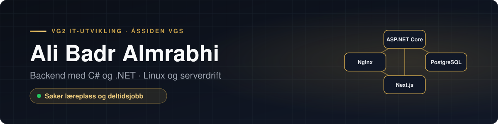
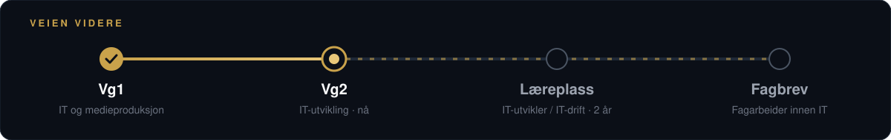

  

  
  
  

## Om meg

Jeg går Vg2 IT-utvikling ved Åssiden videregående skole og liker å forstå hele kjeden – fra koden og databasen til serveren den kjører på.

- 🔧 **Nå:** backend og server for et lager- og logistikksystem for en ekte oppdragsgiver
- 📚 **Lærer:** ASP.NET Core, PostgreSQL og drift med Linux, Docker og Proxmox
- 🎯 **Søker:** læreplass i IT-utviklerfaget eller IT-driftsfaget, og deltidsjobb innen IT

  

## Utvalgt prosjekt

**[Logistikk](https://github.com/AliPluss/logistikk-showcase)** · Lagerstyring, ordre og plukklister for en ekte oppdragsgiver. Jeg har ansvar for backend og satte opp serveren fra bunnen av.

`ASP.NET Core` `PostgreSQL` `JWT` `Next.js` `Proxmox` `Rocky Linux` `Docker` `Nginx`

## Andre prosjekter

| | Prosjekt | Teknologi |
| :---: | --- | --- |
| 🗺️ | **[PlanGraph](https://github.com/AliPluss/planGraph)** – gjør en prosjektidé om til en plan vist som graf · *under utvikling* | Next.js · TypeScript |
| 📦 | **[decortion](https://github.com/AliPluss/decortion)** – JavaScript-bibliotek med decorators, publisert på npm | JavaScript |
| 📝 | **[rest_django](https://github.com/AliPluss/rest_django)** – REST API for en blogg med JWT-innlogging | Python · Django |

## Verktøy

**Daglig**

  

**Har også jobbet med**

  

## Veien videre

  

---

  Læreplass eller deltidsjobb innen IT? Jeg tar gjerne en prat – send meg en melding på <a href="https://www.linkedin.com/in/ali-badr-a-a-almrabhi-5676b9448/">LinkedIn</a>.

